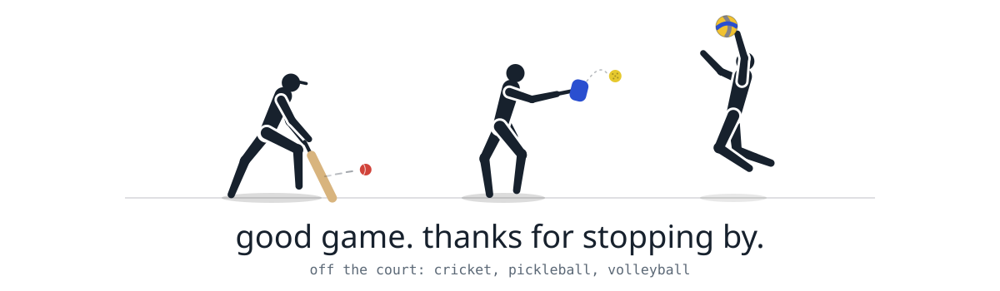

<a href="https://anantpatel.dev">
<picture>
  <source media="(prefers-color-scheme: dark)" srcset="https://raw.githubusercontent.com/anantp1910/anantp1910/main/assets/hero-dark.svg">
  
</picture>
</a>

## Hi, I'm Anant

**AI engineer and full-stack builder**

I build AI products at hackathon speed: agents that get stalled prescriptions filled, a back office that learns from your books, and fall detection for ER waiting rooms.

<picture>
  <source media="(prefers-color-scheme: dark)" srcset="https://raw.githubusercontent.com/anantp1910/anantp1910/main/assets/net-dark.svg">
  
</picture>

### About Me

**Anant** here. I study Computational Data Science with a minor in Statistics (class of 2028, Dean's List every semester) and learn by shipping: six hackathons in 2026, one project at each.

- **Now:** undergraduate researcher training ML models that forecast power-grid oscillations, and building an AI trading engine with full backtesting for the campus quant club.
- **Before:** data analyst intern who turned 1,022+ survey responses into dashboards, reports and a Next.js research site for 8+ departments.
- **I like building:** multi-agent AI systems, real-time apps, fintech and health tech.
- **Off the clock:** VP of finance for a cultural club ($25k+ yearly budget) and treasurer of the badminton club.
- 🏸 **Badminton is my main game:** I played at the CBSE Nationals and finished runner-up at an intercollegiate tournament. I also play 🏏 cricket, pickleball and 🏐 volleyball.
- Open to **internships**, and always up for a hackathon team.

### Things I've Shipped

| project | what it does | my part | built at |
|:--|:--|:--|:--|
| **[Munshi](https://github.com/meetbhojani8989/Munshi)** | An AI back office for small businesses that keeps the books and learns as it goes | self-improving forecast agents (−59% error) | c0mpiled-15, Penn State |
| **[Echo by Relay](https://github.com/anantp1910/EchoByRelay)** | Agents that turn a doctor's one-line order into medicine in the patient's hands | the multi-agent engine | HackGT 13 |
| **[Curio](https://github.com/Ishaannarang22/Curio)** | Thinking, made visible: talk through a topic and watch it become a live whiteboard | multi-agent pipeline and live whiteboard sync | UC Berkeley AI Hackathon 2026 |
| **[kerdos](https://github.com/anantp1910/kerdos)** | Picks the best card for every purchase and auto-invests the rewards | Plaid, live market data, AI advice | Bitcamp 2026 |
| **[Trajectory](https://github.com/anantp1910/Trajectory-AI-Career-and-Curriculum-Copilot)** | Turns a resume into a skill map, a course plan and job-ready next steps | React frontend | c0mpiled-6, Penn State |
| **[WatchCare-AI](https://github.com/anantp1910/WatchCare-AI)** | Spots falls on hospital waiting-room cameras and alerts staff in real time | Android alert app with Firebase | NexHacks, CMU |

### Connect

### Tech Stack

<picture>
  <source media="(prefers-color-scheme: dark)" srcset="https://skillicons.dev/icons?i=py,java,ts,js,r,kotlin,html,css&theme=dark">
  
</picture>
 
<picture>
  <source media="(prefers-color-scheme: dark)" srcset="https://skillicons.dev/icons?i=pytorch,tensorflow,sklearn,opencv,postgres,mongodb,redis,supabase,firebase&theme=dark">
  
</picture>
 
<picture>
  <source media="(prefers-color-scheme: dark)" srcset="https://skillicons.dev/icons?i=react,nextjs,tailwind,threejs,nodejs,androidstudio,aws,vercel,git,github&theme=dark">
  
</picture>

plus pandas, NumPy, Power BI and Tableau

### GitHub Stats

<picture>
  <source media="(prefers-color-scheme: dark)" srcset="https://streak-stats.demolab.com?user=anantp1910&hide_border=true&background=0D1117&ring=3F9C72&fire=E0564C&currStreakNum=EEF0EA&currStreakLabel=EEF0EA&sideNums=EEF0EA&sideLabels=93A0AD&dates=93A0AD&stroke=30363D">
  
</picture>

 

<picture>
  <source media="(prefers-color-scheme: dark)" srcset="https://raw.githubusercontent.com/anantp1910/anantp1910/main/assets/footer-dark.svg">
  
</picture>

